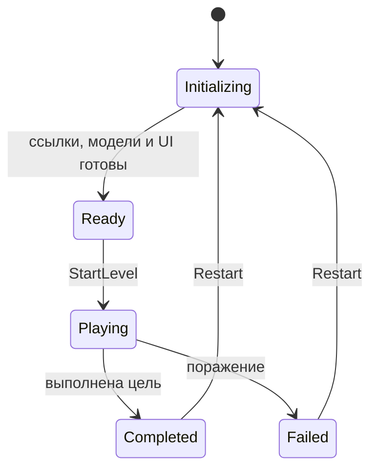

# Ropejump: разбор проекта и план архитектуры

Дата: 17 октября 2026. Проект использует Unity 6000.3.7f1, URP 2D и содержит 50 C#-файлов в `Assets/Scripts`. Разбор выполнен по коду, настройкам, сцене и префабам; запуск в Unity и измерения производительности не выполнялись.

## Основной вывод

Для текущего масштаба достаточно компонентов Unity, явных ссылок между ними и нескольких небольших моделей состояния. Полезная основа уже есть: отдельные компоненты движения и оружия, настройки в ScriptableObject, общий `DamageInfo` и интерфейс `IDamageable`. В `CharController` горизонтальная и вертикальная координаты объединяются перед перемещением Rigidbody2D — этот принцип стоит сохранить.

Главная задача сейчас — назначить одного владельца каждому изменяемому значению. HP, патроны и завершение боя уже имеют несколько независимых путей изменения. Добавление общего `PlayerStatsManager` поверх них только увеличит число связей.

## Git и файлы проекта

На момент начала проверки в индексе было 665 файлов. `git ls-files -ci --exclude-standard` не обнаружил уже отслеживаемых файлов, попадающих под исходные правила исключения. `Library`, `Temp`, `Logs`, `UserSettings` и настройки IDE уже исключались.

В `.gitignore` добавлены временные каталоги Unity, экспорт IDE, отладочные каталоги сборок, схема UI Toolkit, отчёты о сбоях в корне, резервные файлы Blender, недостающие пары с `.meta`, кэши Visual Scripting, временные сцены Test Runner и дополнительные результаты сборки Addressables. Правила каталогов привязаны к корню или точным служебным путям, чтобы одноимённые игровые папки внутри `Assets` оставались доступными для Git. Базовые правила сверены с [шаблоном Unity от github/gitignore](https://github.com/github/gitignore/blob/main/Unity.gitignore).

Что нужно хранить:

- `Assets` и соответствующие `.meta`: GUID обеспечивают связи сцен, префабов и ресурсов. В текущем индексе 348 `.meta` — это ожидаемая часть проекта.
- `ProjectSettings`, `Packages/manifest.json`, `Packages/packages-lock.json`.
- Исходники графики, анимации, шейдеры, данные Input System и ScriptableObject. Большой размер не делает их кэшем.

Кандидат на осознанную очистку: `Assets/TextMesh Pro/Examples & Extras` — 284 отслеживаемых файла, включая `.meta`, около 5,6 МиБ в рабочем дереве. В проверенных сериализованных ассетах вне этой папки GUID-ссылок на её содержимое не найдено. Это ещё не проверка динамических загрузок по строкам. Если примеры не используются, удалить папку через Unity Editor вместе с её `.meta` и проверить сцену. Добавление уже отслеживаемой папки в `.gitignore` само по себе её из Git не уберёт.

Также около 3,8 МиБ занимает `Assets/Settings/Lit2DSceneTemplate.scenetemplate`. Это шаблон сцены, а не автоматически лишний файл. Его необходимость стоит оценить отдельно. Пакеты Timeline, Visual Scripting, Multiplayer Center и Unity Version Control тоже лучше удалять через Package Manager только после проверки использования.

## Проблемы, которые стоит исправить первыми

| Приоритет | Наблюдение | Последствие и место исправления |
| --- | --- | --- |
| Высокий | В префабе игрока одновременно находятся `Health` с начальными 20 HP и `HealthComponent` с максимумом 100 HP. | Оружие и зоны используют новую систему, HUD и старые реакции смерти — старую. Объединить здоровье. См. [префаб игрока](/home/abobo/GMDEV/Ropejump/Assets/Prefubs/chars/Player.prefab:305), [Health](/home/abobo/GMDEV/Ropejump/Assets/Scripts/Health/Health.cs:165), [HealthComponent](/home/abobo/GMDEV/Ropejump/Assets/Scripts/Health/HealthComponent.cs:46). |
| Высокий | `HealthComponent.onHealthChanged` и `onDeath` в префабе игрока и у противника в сцене имеют пустые списки вызовов; подписок из рабочего кода нет. | Урон меняет новое HP, но не приводит к обновлению старого HUD, отключению действий и завершению раунда. |
| Высокий | Подписки на смерть и вызов `EndRound` после таймера закомментированы. | После истечения времени `roundActive` остаётся истинным и бой не завершается. См. [RoundManager](/home/abobo/GMDEV/Ropejump/Assets/Scripts/Managers/RoundManager.cs:66). |
| Высокий | `Weapon.Reload` вызывает заполнение магазина до максимума без списания запаса и ожидания. Ручная перезарядка реализована другим путём. | Автоперезарядка даёт бесплатные патроны. Нужна общая операция для обоих режимов. См. [Weapon](/home/abobo/GMDEV/Ropejump/Assets/Scripts/Weapons/Weapon.cs:190), [WeaponAmmo](/home/abobo/GMDEV/Ropejump/Assets/Scripts/Weapons/WeaponAmmo.cs:54). |
| Средний | Любой существующий `StatusEffectDoT` просто получает `Refresh`; тип, DPS и источник второго эффекта не учитываются. | Выход из кислоты после огня может продлить старое горение вместо отдельного эффекта кислоты. См. [HazardZone](/home/abobo/GMDEV/Ropejump/Assets/Scripts/LevelComponents/HazardZone.cs:281). |
| Средний | `SlowEffect.Multiplier` записывается, но игровое движение его не читает. `RubberBandController.CanAttack` также нигде не проверяется. | Замедление и запрет атаки по фазе каната фактически не подключены. См. [SlowEffect](/home/abobo/GMDEV/Ropejump/Assets/Scripts/LevelComponents/HazardZone.cs:618), [CanAttack](/home/abobo/GMDEV/Ropejump/Assets/Scripts/Controllers/RubberBandController.cs:71). |

Дальше по важности:

- [LevelManager](/home/abobo/GMDEV/Ropejump/Assets/Scripts/Managers/LevelManager.cs:111) объединяет запуск боя, ссылки на персонажа, каталог оружия, инвентарь, PlayerPrefs, спавн и вызовы UI. Его полезно постепенно разделить по этим обязанностям.
- [Singleton](/home/abobo/GMDEV/Ropejump/Assets/Scripts/Extras/Singleton.cs:23) способен автоматически создать менеджер без настроенных Inspector-ссылок и переносит найденный объект в `DontDestroyOnLoad`. `OnDestroy` принимает обычное уничтожение за выход из приложения. Кроме того, собственные `Awake` у части наследников не вызывают базовую регистрацию. Для менеджеров конкретной сцены это ненадёжный жизненный цикл.
- [WeaponAmmo.Awake](/home/abobo/GMDEV/Ropejump/Assets/Scripts/Weapons/WeaponAmmo.cs:11) загружает данные до вызовов `SetOwner` и `Setup` после `Instantiate`. Не стоит делать загрузку, зависящую от владельца, в `Awake` оружия.
- [AIState](/home/abobo/GMDEV/Ropejump/Assets/Scripts/AI/Core/AIState.cs:29): условие `Transitions != null || Transitions.Length > 1` обращается к `Length` при `null`. Достаточна ранняя проверка `if (Transitions == null) return;`; затем стоит определить, разрешён ли больше чем один переход за обновление.
- [ObjectPoolCtrl.GetObject](/home/abobo/GMDEV/Ropejump/Assets/Scripts/PoolThings/ObjectPoolCtrl.cs:39) включает переиспользованный объект, но при расширении возвращает новый выключенным. У пула должен быть единый контракт получения объекта.
- В [HazardZone.TickDamageAll](/home/abobo/GMDEV/Ropejump/Assets/Scripts/LevelComponents/HazardZone.cs:331) каждый кадр создаётся новый список ключей. После исправления поведения можно переиспользовать буфер и проверить аллокации профайлером.

## Состояние уровня

Нужно различать состояние прохождения уровня, фазу движения на канате и состояние AI. Существующий `StateController` относится к AI; превращать его в контроллер всего уровня не стоит.

Если один уровень соответствует одному бою, достаточно одного `LevelFlowController`, который заменит управление жизненным циклом из `LevelManager` и `RoundManager`. Если появятся несколько раундов на уровень, модель раунда можно выделить позже.

Предлагаемая схема:



Пауза — отдельный флаг поверх текущей фазы. Это позволит продолжить именно ту фазу, которая была активна до паузы. Позже так же можно приостановить обратный отсчёт перед боем.

Разделение данных:

| Объект | Ответственность |
| --- | --- |
| `LevelDefinition`, ScriptableObject | Длительность, правила победы, начальные параметры, описание спавна. |
| `LevelSession`, обычный C#-объект | Текущая фаза, пауза, оставшееся время, результат, прогресс целей и идентификатор попытки. |
| `LevelFlowController`, MonoBehaviour | Связывает модель с персонажами, канатами, спавнером и UI; передаёт время в `Tick`. |
| `LevelSnapshot`, сохраняемые данные | Снимок нужного прогресса без ссылок на объекты сцены. Добавляется при появлении сохранений. |

Это границы ответственности, а не требование немедленно создать все перечисленные классы. Начать можно с одного компонента жизненного цикла и небольшой модели состояния; выделять сохранение и дополнительные интерфейсы по мере появления реальных потребителей.

Переходы проходят через один метод, например `TryFinish(LevelResult result)`. Повторное завершение не должно повторно выдавать награду или открывать экран результата. Причина завершения и победитель — типизированные данные; текст «Player 1 wins» формирует UI.

При входе в `Playing` запускаются канаты, AI, таймер и игровые команды. При завершении останавливаются действия персонажей, спавн, таймер и отложенные действия текущей попытки. Одного `StopCycle` недостаточно: ввод и оружие сейчас живут отдельно. Для одновременной смерти и истечения таймера нужно явно задать правило результата; если возможен двойной нокаут, сигналы стоит разрешать совместно за шаг симуляции.

Проверки доступа к действиям полезно объединить:

```text
CanAct    = Session.Phase == Playing && !Session.IsPaused && Health.IsAlive
CanAttack = CanAct && Rope.CanAttack && !Effects.BlocksAttack && !Weapon.IsReloading
```

Эту проверку должен проходить общий метод выполнения команды как от игрока, так и от AI. Блокировка только чтения мыши не остановит вызов атаки из другого компонента.

Для глобальной паузы можно использовать `Time.timeScale = 0`, одновременно блокируя игровые команды. При этом Unity останавливает `FixedUpdate` и ожидания `WaitForSeconds`; меню должно использовать независимое от игрового времени обновление. См. [Time.timeScale](https://docs.unity3d.com/6000.3/Documentation/ScriptReference/Time-timeScale.html).

Связи сцены удобно собрать в небольшом `LevelContext` через Inspector. В `Awake` компоненты получают локальные зависимости, а явный этап инициализации готовит модели и подписки до запуска боя. Порядок одинаковых callbacks у разных объектов в общем случае не гарантирован, поэтому обмен данными между менеджерами из их `Awake` создаёт риск. См. [порядок событий Unity](https://docs.unity3d.com/6000.3/Documentation/Manual/execution-order.html).

## Здоровье, патроны и характеристики

Не стоит объединять всё в универсальный словарь чисел. Максимальное здоровье и скорость — характеристики; текущее HP и запас патронов — ресурсы; горение и оглушение — активные эффекты с поведением.

| Область | Настройки | Изменяемое состояние и владелец |
| --- | --- | --- |
| Здоровье и щит | `HealthDefinition`: начальные и максимальные значения, сопротивления | `HealthComponent`: текущее HP, щит, неуязвимость, признак жизни |
| Оружие | Уже существующий `WeaponDataItem`: урон, магазин, темп, ссылка на боеприпас; добавить длительность перезарядки | `WeaponInstanceState`: патроны магазина, время следующего выстрела, ход перезарядки |
| Запас боеприпасов | Тип боеприпаса и лимит | `AmmoInventory`: количество по `AmmoId`, если оружие делит общий запас; иначе по `WeaponId` |
| Производные характеристики | Базовые скорость, MaxHP, множитель урона | `CharacterStats`: результат базовых значений и активных модификаторов |
| Временные эффекты | `StatusEffectDefinition`: тип, длительность, тики, правила накопления | `StatusEffectController` на конкретном персонаже |

ScriptableObject удобно оставить общими настройками. Текущее HP, оставшиеся патроны, таймеры и экземпляры эффектов принадлежат каждому персонажу отдельно. Это архитектурное правило проекта: сами ScriptableObject допускают изменение, но при общей ссылке это будет общее состояние. Их использование для разделяемых настроек описано в [документации Unity](https://docs.unity3d.com/6000.3/Documentation/Manual/class-ScriptableObject.html).

### Здоровье и получение урона

В качестве основы лучше оставить `HealthComponent`: он уже поддерживает `IDamageable`, типы урона, сопротивления и события. Старый `Health` удалять после переноса его настроек и потребителей.

Пример последовательности применения урона:

```text
Projectile / DamageDealer / Hazard / DoT
  → получатель IDamageable
  → проверки жизни и иммунитета
  → сопротивление
  → поглощение щитом
  → уменьшение HP
  → DamageApplied / HealthChanged / Died
```

Порядок сопротивления и щита — правило баланса, его нужно закрепить в одном месте. Сейчас щит присутствует в старом `Health`, но урон его не расходует, а в HUD передаются нули.

Нужные инварианты: `0 <= HP <= MaxHP`, положительное лечение, одно событие смерти на жизнь и отдельный явный `ResetForSpawn`. При снижении MaxHP следует определить правило для текущего HP: например, ограничивать новым максимумом. При повторном появлении сбрасываются неуязвимость, эффекты и таймеры. Обычное скрытие объекта не обязано означать полное восстановление.

Событие урона должно передавать фактически снятый щит и HP, а не только запрошенный `DamageInfo`. Иначе всплывающий урон и статистика будут показывать значение до сопротивления. Для DoT стоит отдельно определить, применяются ли к нему краткие i-frames от попаданий.

Если коллайдеры попаданий окажутся на дочерних объектах, они должны ссылаться на общего получателя урона персонажа. Нынешний `TryGetComponent<IDamageable>` ищет только на самом объекте коллайдера. Небольшой компонент `Hurtbox` с явной ссылкой на получателя позволит учитывать несколько коллайдеров как одну цель одной атаки.

Отдельный `CharacterDeathHandler` реагирует на смерть: блокирует управление, оружие, AI и движение, запускает визуальную реакцию. Само здоровье не должно искать менеджер уровня или управлять элементами HUD. `HealthBarPresenter` подписывается на изменение здоровья и сразу читает текущий снимок, чтобы не зависеть от уже прошедшего события инициализации. Подписки снимаются при отключении/уничтожении представления.

### Патроны и перезарядка

В памяти хранить магазин экземпляра оружия и запас инвентаря. Оба варианта перезарядки, ручной и автоматический, запускают одну операцию; различается только причина её начала.

При завершении перезарядки переносить:

```text
transfer = min(MagazineCapacity - MagazineAmmo, ReserveAmmo)
MagazineAmmo += transfer
ReserveAmmo  -= transfer
```

При вместимости 10, трёх патронах в магазине и пяти в запасе результат — 8/0. Если применяется модель переноса в конце перезарядки, отмена до завершения ничего не меняет. Для дробовика с дозарядкой по одному патрону перенос происходит по отдельным подтверждённым шагам.

Логика перезарядки задаёт длительность и прогресс, а Animator и полоса прогресса отображают их. Не стоит вычислять правила боя по текущему клипу аниматора. При смене оружия сохраняется его модель магазина, а старый callback перезарядки отменяется или отклоняется по идентификатору операции.

Идентификатор `WeaponId` использовать для сохранений и поиска, `WeaponName` оставить названием. Вместо `_getDataByType` с цепочкой строковых сравнений достаточно каталога `WeaponDataItem[]` и словаря по ID. Покупка/подбор другого типа патронов не должна читать магазин случайно экипированного оружия.

`PlayerPrefs` сейчас используется как хранилище части текущего инвентаря. Лучше загрузить начальное состояние один раз, работать с моделями в памяти и передавать снимок в `SaveService` на контрольных точках. Для начала нового забега и продолжения сохранения нужны разные явные операции. Пользовательские настройки можно оставить в PlayerPrefs.

## Эффекты: горение, яд, замедление, оглушение

Один `StatusEffectController` на персонаже содержит коллекцию экземпляров эффектов. Начать можно с обычного списка и нескольких типов поведения; отдельные пакеты и сложный фреймворк для этого не нужны.

Настройка эффекта содержит ID, длительность, интервал тика, силу, максимальное число стаков и правило повторного применения. Экземпляр хранит свою настройку, источник, оставшееся время, накопитель тика и число стаков.

| Правило | Поведение при повторном применении |
| --- | --- |
| RefreshDuration | Обновить время существующего эффекта того же вида. |
| StackIntensity | Увеличить силу/число стаков до лимита. |
| Independent | Добавить отдельный экземпляр со своим источником и таймером. |
| StrongestWins | Применять самый сильный модификатор среди активных. |

Огонь и кислота должны иметь разные ID. Для повторного огня нужно отдельно выбрать группировку по типу или по источнику. Метод добавления возвращает `EffectHandle`, по которому можно удалить именно этот экземпляр или вклад конкретной зоны.

Для замедления от зон удобно начать с `StrongestWins`: при множителях 0,7 и 0,5 действует 0,5; выход из второй зоны оставляет 0,7; выход из первой возвращает 1. Прямое присваивание базовой скорости при выходе из одной зоны сломает другие эффекты.

Итоговую горизонтальную скорость можно вычислять как `baseSpeed * phaseMultiplier * slowMultiplier`. Отдельно решить, замедляет ли эффект вертикальное движение каната: это игровое правило, а не побочный результат изменения общего поля скорости.

DoT должен передавать урон через общий путь `DamageInfo`. Накопитель времени обрабатывает все наступившие тики; также нужно определить тик при наложении и обработку последней неполной секунды. Нынешний компонент округляет DPS до целого и тикает раз в секунду, поэтому короткие и слабые эффекты могут не причинить урон.

При смерти, рестарте и возврате объекта в пул эффекты очищаются явно согласно правилам игры. Для зон необходимо снимать их вклады при деактивации и уничтожении, а не полагаться только на выход из триггера. Визуальные эффекты подписываются на добавление/удаление статуса; `EffectManager` для VFX не должен владеть игровыми таймерами горения.

## Порядок внедрения

1. Объединить здоровье на `HealthComponent`, перенести значения из префабов и сцены, подключить HUD и обработчик смерти. Проверить получение урона игроком и врагом.
2. Назначить одного владельца жизненного цикла боя. Подключить смерть и таймер к завершению, добавить запрет действий вне игры и паузу. Проверить повторный запуск.
3. Выделить состояние магазинов и запаса в памяти. Объединить ручную и автоматическую перезарядку, затем вынести сохранение.
4. Объединить DoT и модификаторы в контроллер эффектов с явными правилами наложения.
5. После стабилизации поведения сократить глобальные менеджеры, убрать неиспользуемый код и примеры, измерить аллокации и решить, где нужен пул снарядов.

При изменении префабов действия в Unity Editor обязательны: перенести значения здоровья, обновить ссылки UI и раунда, проверить overrides сцены, сохранить ассеты с их `.meta`. Простое удаление старого скрипта раньше миграции оставит отсутствующие компоненты.

Проверки для будущих изменений: смертельный урон завершает бой ровно один раз; таймер завершает раунд; на паузе не расходуются патроны и не идут эффекты; автоматическая перезарядка не создаёт патроны; огонь и кислота сосуществуют по заданным правилам; две зоны замедления корректно снимаются в любом порядке; рестарт и повторная активация объекта не переносят состояние предыдущей попытки. Арифметику ресурсов и переходы модели удобно проверить в EditMode, сценовые связи и жизненный цикл — в PlayMode.
